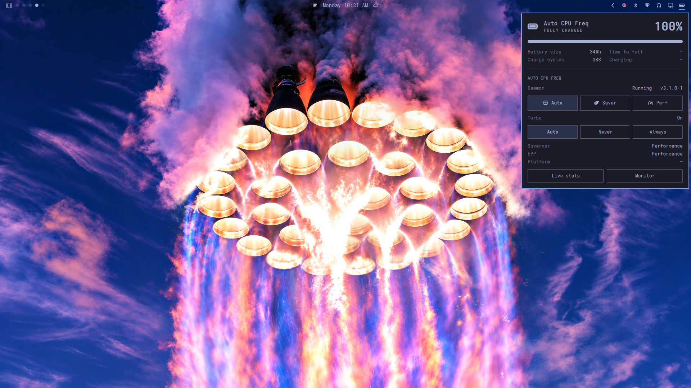

# Auto CPU Freq

[](https://github.com/tcballard/omarchy-badges)

Battery, [auto-cpufreq](https://github.com/AdnanHodzic/auto-cpufreq) power state,
and CPU power tuning from the Omarchy bar.



A clone of the built-in `omarchy.power` widget (battery hero, progress bar and
stats) whose power section drives **auto-cpufreq** instead of
power-profiles-daemon. Pick the governor override (Auto / Saver / Perf) and the
turbo policy (Auto / Never / Always) straight from the popout, and open the
live `auto-cpufreq --stats` / `--monitor` views.

Kinds: service, bar-widget

## GitHub topics

Pair this badge with `omarchy` and `omarchy-plugin` in your GitHub repository's
About topics. The badge does not set topics automatically. Keep other relevant
topics too. This is a community discovery convention, not marketplace approval.

## Requirements

- Omarchy 4 with Quattro shell-plugin support.
- The `auto-cpufreq` package (AUR `auto-cpufreq`, or the AUR helper of choice).
    Its systemd service performs the actual CPU tuning; this plugin only reads
    its state and sets governor/turbo overrides.
- A privileged helper at `/usr/local/bin/autocpufreq-priv` plus a
  `/etc/sudoers.d/autocpufreq` drop-in, installed by
  `extras/install-privilege.sh`. Without it the plugin still works but mode/turbo
  changes fall back to a `pkexec` prompt.
- Do **not** run auto-cpufreq alongside TLP or power-profiles-daemon; they fight
  over the same CPU knobs. `extras/install-daemon.sh` disables and masks
  power-profiles-daemon for you.

## Installation

Install the plugin from this repository:

```bash
omarchy plugin add https://github.com/wixisse/omarchy-auto-cpufreq.git --enable
```

For a local checkout:

```bash
omarchy plugin add "$(pwd)" --enable
```

Then install the backend once (needs an interactive sudo password, so run it in
a terminal):

```bash
bash extras/install.sh
```

`extras/install.sh` is idempotent. It runs `extras/install-daemon.sh`, which
installs the `auto-cpufreq` package, **disables and masks
`power-profiles-daemon`** (it and auto-cpufreq both manage CPU power and must not
run together), and enables `auto-cpufreq.service`. It then installs the
privileged helper (`extras/install-privilege.sh`) used for mode/turbo changes.

To install only the daemon, without the privileged helper:

```bash
bash extras/install-daemon.sh
```

## Validation and tests

```bash
./tests/run
omarchy plugin validate .
```

## Update

```bash
omarchy plugin update othmane-wadi.autocpufreq
```

## Removal

```bash
omarchy plugin remove othmane-wadi.autocpufreq
sudo bash extras/install-privilege.sh --uninstall
```

## Security

Omarchy plugins run as unsandboxed code inside `omarchy-shell`. Review this
repository and its dependencies before enabling it.

The privileged helper accepts only a fixed set of keywords
(`force powersave|performance|reset`, `turbo always|auto|never`) and maps each to
one fixed `auto-cpufreq` invocation. No caller-supplied string is passed through
a shell or used to build a path, so the sudoers drop-in does not grant a
general-purpose root shell.

## License

MIT © 2026 othmane-wadi
